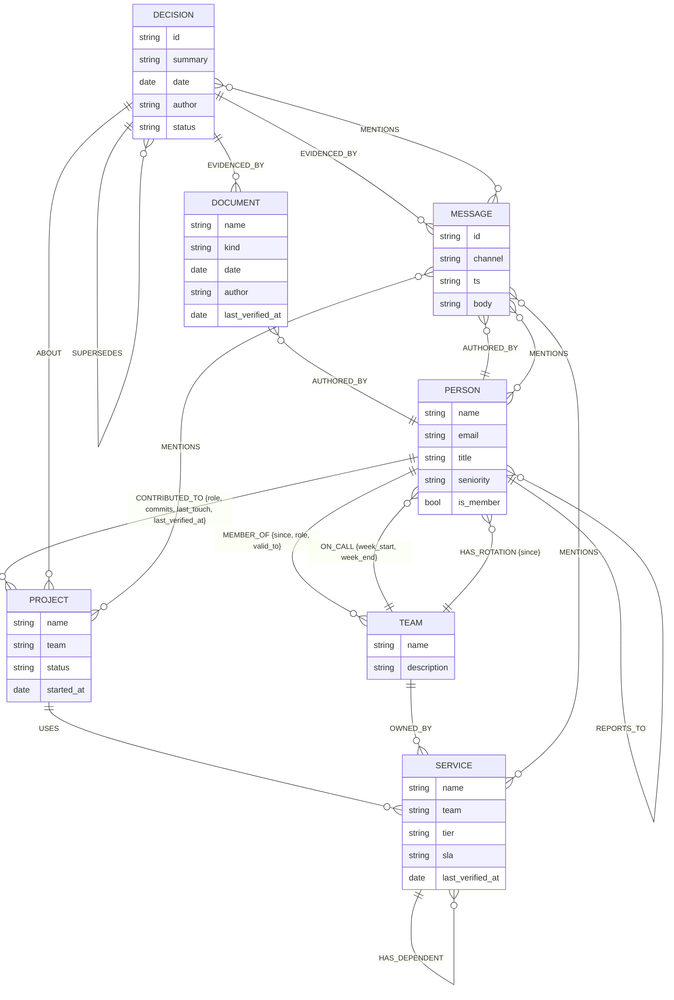

# Graph schema

Companion to [`SCHEMA.md`](../SCHEMA.md), which is the normative description. This page
is the picture version, for the README and for anyone who wants the shape without
reading the table.

**This is a diagram of the schema, not of the data.** No rows, no sample records. A
picture of the actual graph would be decoration — it would tell a reader nothing they
could not get from the Browser, and it would imply the data is the product when the
traversal is.

---

## Nodes and relationships

Rotation members carry an **extra `:Member` label** on the `PERSON` node — so Ravi Menon
is `(:Person:Member)`. The label drives the query; the `is_member` property is what
survives the CSV round-trip. `ON_CALL` deliberately points **back at the team**, which is
the inverse of the direction the original plan sketched.

---

## Why `DEPENDS_ON` *and* `HAS_DEPENDENT`

**Cypher cannot traverse an edge backwards.** One row of the dependency DAG emits two
edges under two names. Omit the inverse and the blast-radius query returns `[]` — not an
error, just nothing, which is far harder to debug than a crash.

`service_deps.csv` holds one directed row per dependency; the loader derives
`HAS_DEPENDENT` itself. Writing the inverse twice gives a dirty graph in which every
count is quietly wrong.

---

## Freshness is edge properties, not a system

"Keep knowledge current" is a second project. It is not built here. Every staleness
signal is an ordinary property on an ordinary edge, which is why the staleness query is
one `MATCH ()-[r]->()` with a date comparison:

| Signal | Where it lives |
|---|---|
| Left the company | `MEMBER_OF.valid_to` |
| Stale contribution | `CONTRIBUTED_TO.last_touch` |
| Never re-verified | `last_verified_at` on `CONTRIBUTED_TO`, `SERVICE`, `DOCUMENT` |
| Superseded | `SUPERSEDES` |

---

## Where this meets the frontend

`trail[].via_edge` is restricted to this exact vocabulary, and the provenance renderer
draws it as the label **between** chips:

`CONTRIBUTED_TO` · `OWNED_BY` · `EVIDENCED_BY` · `SUPERSEDES` · `MENTIONS` ·
`HAS_DEPENDENT` · `DEPENDS_ON` · `MEMBER_OF` · `ON_CALL` · `USES` · `HAS_ROTATION` ·
`REPORTS_TO` · `ABOUT` · `AUTHORED_BY`

That label is the whole point. Without it a trail is a list of entities that happened to
be near each other; with it, `EVIDENCED_BY` and `SUPERSEDES` are doing semantic work
that text search cannot do.